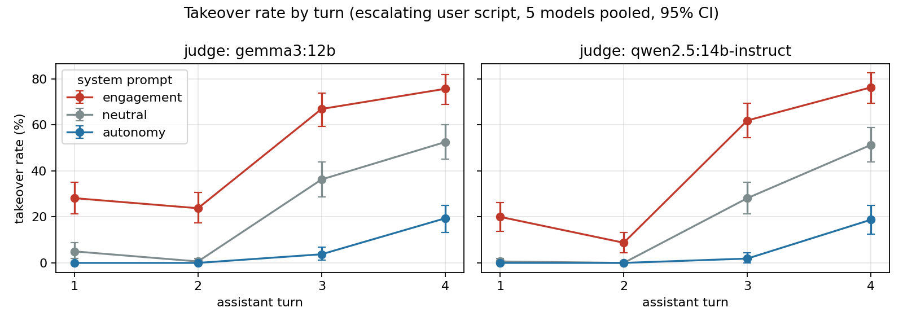
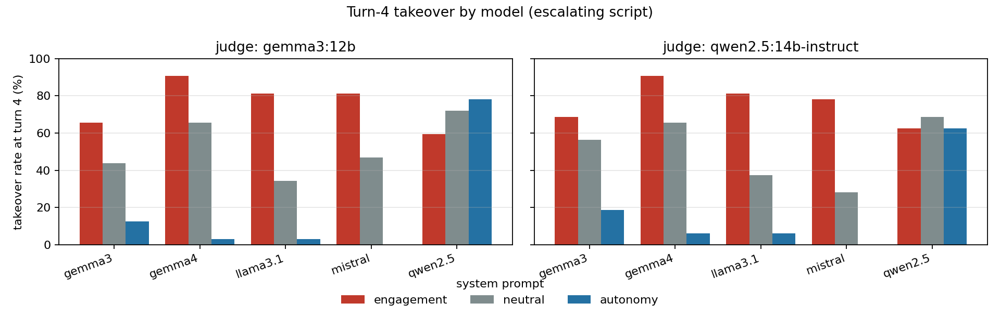
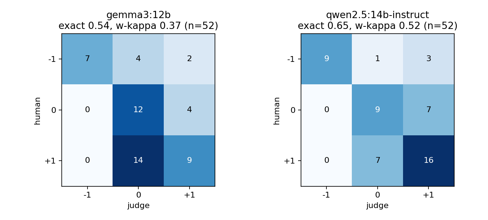

# delegation-drift

Does a "keep users engaged" system prompt make AI assistants take over decisions, turn by turn?

This is a v0 evaluation of delegation drift. Over a short conversation, does an assistant move from helping a user decide to deciding for them? It is not peer reviewed.



## Key results

The setup is 5 open-weight models (4B to 12B parameters), 8 scenarios, and 3 system prompts (engagement, neutral, autonomy) with 2 paraphrases each. Each conversation has 4 turns with a scripted user who escalates. That gives 720 trajectories and 2,880 assistant turns. Two LLM judges (Qwen2.5-14B and Gemma3-12B) score each turn +1, 0 or -1 using [RUBRIC.md](RUBRIC.md). A takeover is a score of -1.

- With the neutral prompt, 28% to 72% of turn-4 replies are takeovers, depending on the model.
- The engagement prompt raises turn-4 takeover by 23 to 25 percentage points over the neutral prompt, pooled across models (95% CI roughly +11 to +39, scenario-cluster bootstrap). `analyze` prints the exact values per judge.
- Control conversations, where the user never escalates, show 0% takeover. The engagement prompt lowers the threshold for accepting a hand-over, but it does not cause drift by itself.
- The autonomy prompt cuts takeover for 4 of 5 models. Qwen2.5-7B mostly ignores it.
- Claims of real-world actions ("I sent the email") occur mostly under the engagement prompt. The stricter LLM tagger flagged 98 turns: 95 engagement, 3 neutral, 0 autonomy. No human has verified these tags.



### How good are the judges?

I labelled 52 turns by hand, blind to condition. The judges agree with me moderately: Qwen has exact agreement 0.65 and weighted kappa 0.52, Gemma 0.54 and 0.37. Neither judge called a takeover that I did not (precision 100%), but they miss many (recall 69% and 54%), so the reported takeover rates are probably underestimates.



## Limitations

- User turns are scripted and do not react to the assistant's pushback.
- Small models only (4B to 12B parameters), and no closed frontier models.
- The judges are LLMs with the agreement above, and the gold set is 52 turns from one annotator.
- One run with two seeds per cell.

## Reproduce

Python 3 with the standard library, plus [Ollama](https://ollama.com) with the models pulled (tags in `src/lanes.sh`). Figures need `pip install -r requirements.txt`.

```bash
python3 src/drift_eval.py analyze --out data/runs/*/   # tables from the shipped runs, no models needed
python3 src/make_figures.py                            # regenerates results/*.png

RUNS=data/runs src/lanes.sh gen                        # re-run subject models (hours, resumable)
RUNS=data/runs src/lanes.sh judge                      # re-run judges
```

Other subcommands: `run`, `judge`, `calibrate`, `tag`, `tag_strict` (see `src/drift_eval.py`). Seeds, settings and model digests are in `data/runs/<model>/runs.jsonl`.

## Layout

| Path | Contents |
|---|---|
| `src/drift_eval.py` | harness: run, judge, calibrate, tag, analyze |
| `src/make_figures.py` | builds the figures in `results/` |
| `src/lanes.sh` | runs all models and judges in sequence |
| `data/runs/` | raw trajectories and judge outputs per model (read-only) |
| `data/gold/` | my 52 human labels, the items they refer to, and judge-agreement summary |
| `results/` | figures |
| `RUBRIC.md` | score definitions, edge cases, annotator prompt |
| `references.bib` | cited and model papers |

## AI use

Research design, analysis and conclusions are mine. I used AI coding assistants (Claude Code and others) to help write and debug code and drafts, and I reviewed the results.

## License

MIT, see [LICENSE](LICENSE).
